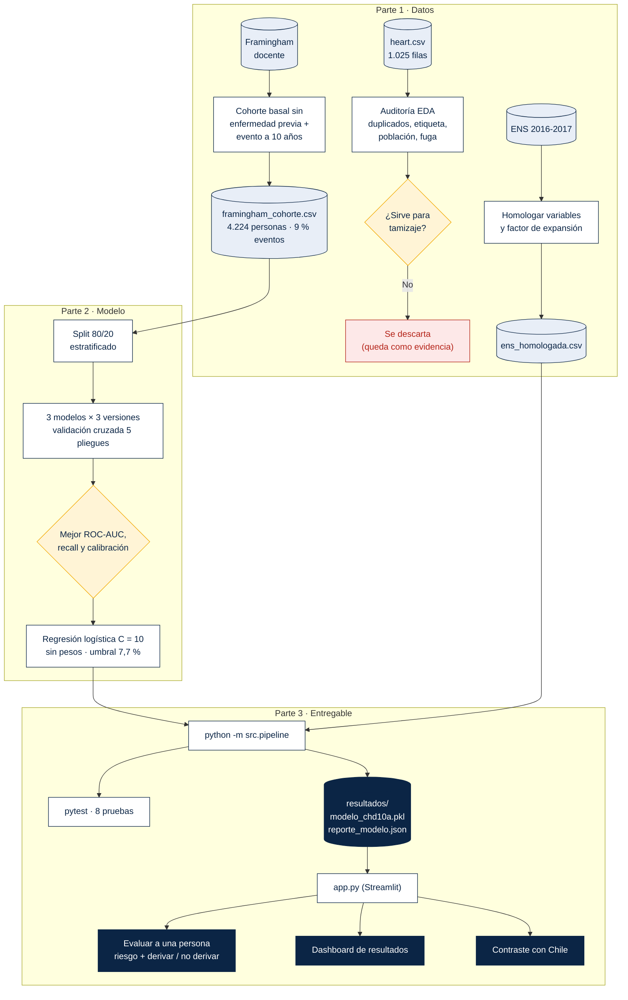
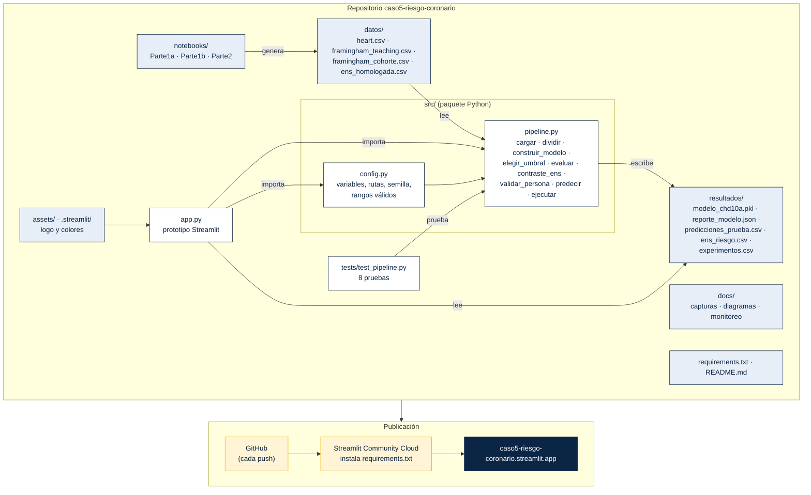

# Caso 5 · Riesgo coronario a 10 años

**Gestión de Proyectos de Datos (SCY1102) · Duoc UC · Parte 3: Entregable funcional**

Modelo de tamizaje que estima el riesgo de un evento coronario en los próximos 10 años a partir de
datos de un control preventivo (edad, presión, colesterol, glicemia, IMC, tabaquismo, diabetes y uso
de antihipertensivos), e indica si conviene derivar a evaluación cardiovascular.

| | |
|---|---|
| Datos de entrenamiento | Cohorte de Framingham, 4.224 personas, 9 % con evento (Parte 1) |
| Modelo | Regresión logística sin pesos de clase (C = 10) + umbral de derivación (Parte 2) |
| Umbral | 7,7 % de riesgo: el más alto que detecta al menos 75 % de los casos en validación cruzada |
| Prueba (845 personas) | ROC-AUC 0,76 · Recall 0,74 · Precisión 0,17 · Brier 0,076 |
| Contraste | ENS 2016-2017 ponderada: riesgo medio estimado 6,6 % en Chile |

**▶ Prototipo en línea:** https://caso5-riesgo-coronario.streamlit.app  
**▶ Tablero del proyecto (Trello):** https://trello.com/b/UBF3q0qM/caso-5-riesgo-coronario-evaluacion-3

> Prototipo académico. No reemplaza una evaluación clínica.

## Estructura

```
caso5-riesgo-coronario/
├── datos/
│   ├── heart.csv                # dataset original del caso (se descarta en la Parte 1)
│   ├── framingham_teaching.csv  # Framingham docente, insumo de la Parte 1
│   ├── framingham_cohorte.csv   # salida de la Parte 1, entrada del modelo
│   └── ens_homologada.csv       # ENS 2016-2017 con las mismas variables
├── notebooks/
│   ├── Parte1a_Limpieza_heart_Caso5.ipynb              # EDA y diagnóstico de heart.csv
│   ├── Parte1b_Preparacion_Framingham_ENS_Caso5.ipynb  # cohorte Framingham + ENS
│   └── Parte2_Modelo_Caso5.ipynb                       # comparación de modelos (v1–v3)
├── src/
│   ├── config.py                # variables, rutas, semilla y rangos válidos
│   └── pipeline.py              # cargar → procesar → entrenar → evaluar → guardar
├── resultados/                  # lo genera el pipeline
│   ├── modelo_chd10a.pkl        # pipeline entrenado + umbral + variables
│   ├── reporte_modelo.json      # métricas, matriz, ROC, calibración, por sexo, odds, ENS
│   ├── predicciones_prueba.csv
│   ├── ens_riesgo.csv
│   └── experimentos.csv         # registro de la Parte 2
├── tests/test_pipeline.py       # 8 pruebas, incluida la reproducción de la Parte 2
├── app.py                       # prototipo en Streamlit
├── assets/logo_duoc.png         # logo del encabezado
├── .streamlit/config.toml       # colores de la app
├── docs/capturas/               # pantallas del prototipo
├── docs/diagramas/              # flujo del proyecto y estructura del paquete (.mmd y .png)
├── docs/monitoreo/              # Parte 4: copia del tablero Trello al 23-11 (tablero_trello.csv y .jpg)
└── requirements.txt
```

## Etapas del proyecto

| Parte | Qué se hizo | Dónde |
|---|---|---|
| 1. Datos | EDA de heart.csv y decisión de descartarlo; preparación de Framingham y ENS | `notebooks/Parte1a…`, `notebooks/Parte1b…` |
| 2. Modelo | Regresión logística, random forest y XGBoost; métricas y registro de experimentos | `notebooks/Parte2…`, `resultados/experimentos.csv` |
| 3. Entregable | Pipeline reproducible, prototipo en Streamlit, pruebas y este repositorio | `src/`, `app.py`, `tests/` |
| 4. Monitoreo | Tablero Kanban en Trello, tareas planificadas vs. ejecutadas, reportes de estado y matriz de desviaciones | [Trello](https://trello.com/b/UBF3q0qM/caso-5-riesgo-coronario-evaluacion-3), `docs/monitoreo/` |

Abrir los notebooks directamente en Colab:
[Parte 1a](https://colab.research.google.com/github/LeonardoAmundarain/caso5-riesgo-coronario/blob/main/notebooks/Parte1a_Limpieza_heart_Caso5.ipynb) ·
[Parte 1b](https://colab.research.google.com/github/LeonardoAmundarain/caso5-riesgo-coronario/blob/main/notebooks/Parte1b_Preparacion_Framingham_ENS_Caso5.ipynb) ·
[Parte 2](https://colab.research.google.com/github/LeonardoAmundarain/caso5-riesgo-coronario/blob/main/notebooks/Parte2_Modelo_Caso5.ipynb)

La primera celda de cada notebook busca sola la carpeta de trabajo: usa la carpeta compartida del equipo
en Drive si existe; si no, clona este repositorio en Colab; y en un computador usa la raíz del repositorio
aunque el notebook se abra desde `notebooks/`.

## Diagramas

### Flujo del proyecto

De los datos de entrada al prototipo, pasando por la auditoría de heart.csv, la cohorte de Framingham y el modelo final.
Imagen: [`docs/diagramas/flujo_proyecto.png`](docs/diagramas/flujo_proyecto.png)



### Estructura del paquete

Cómo se relacionan las carpetas y los módulos del repositorio, y cómo se publica la app.
Imagen: [`docs/diagramas/paquete_proyecto.png`](docs/diagramas/paquete_proyecto.png)



## Cómo ejecutarlo

```bash
git clone https://github.com/LeonardoAmundarain/caso5-riesgo-coronario.git
cd caso5-riesgo-coronario
pip install -r requirements.txt

# 1. Entrenar y guardar el modelo (≈ 2 segundos)
python -m src.pipeline

# 2. Comprobar que todo funciona
python -m pytest -q

# 3. Abrir el prototipo en http://localhost:8501
streamlit run app.py
```

Opciones del pipeline:

```bash
python -m src.pipeline --datos otra/carpeta --salida otra/salida   # otras rutas
python -m src.pipeline --sin-ens                                   # sin el contraste con Chile
```

### En Google Colab

```python
!git clone -q https://github.com/LeonardoAmundarain/caso5-riesgo-coronario.git
%cd caso5-riesgo-coronario
!pip install -q -r requirements.txt
!python -m src.pipeline
!python -m pytest -q
```

## Qué hace el pipeline

1. **Carga y valida** la cohorte: columnas requeridas, sin IDs repetidos y etiqueta 0/1.
2. **Divide** 80/20 estratificado (`random_state=42`), igual que la Parte 2.
3. **Procesa** dentro de un `Pipeline` de scikit-learn: mediana + escalado en continuas, moda en
   binarias. Así las medianas y el escalado se calculan solo con el entrenamiento.
4. **Elige el umbral** con predicciones de validación cruzada (5 pliegues) sobre el entrenamiento.
5. **Entrena** con todo el entrenamiento y **evalúa una sola vez** en la prueba.
6. **Guarda** el modelo, un reporte JSON con todo lo que muestra el dashboard y las predicciones.
7. **Contrasta** con la ENS ponderada para estimar cuánto habría que recalibrar.

Con la misma semilla, cada ejecución entrega exactamente las mismas métricas; el test
`test_reproduce_parte2` lo comprueba contra los números del cuaderno de la Parte 2.

## El prototipo

- **Evaluar a una persona:** formulario con validación de rangos (p. ej., la diastólica debe ser menor
  que la sistólica). Entrega el riesgo, la indicación de derivar o no, el riesgo observado en personas
  parecidas de la cohorte y qué factores lo suben o lo bajan.
- **Resultados del modelo:** métricas de prueba, matriz de confusión, curva ROC, calibración,
  desempeño por sexo, odds ratios y registro de experimentos.
- **Contraste con Chile:** riesgo medio estimado en la ENS por sexo y tramo de edad.

## Usar el modelo desde otro código

```python
from src.pipeline import cargar_modelo, predecir
m = cargar_modelo()
riesgo, derivar = predecir(m, {"AGE": 60, "SEX": 1, "SYSBP": 150, "DIABP": 90, "TOTCHOL": 260,
                               "GLUCOSE": 100, "BMI": 28, "HEARTRTE": 75, "CURSMOKE": 1,
                               "CIGPDAY": 20, "DIABETES": 0, "BPMEDS": 0})
# riesgo ≈ 0,301 → derivar = True
```

## Limitaciones conocidas

- Con un umbral único, el modelo detecta 86 % de los casos en hombres y 62 % en mujeres. Se propone
  evaluar un umbral por sexo.
- Está entrenado con población estadounidense de mediados del siglo XX. Antes de usarlo en Chile hay
  que recalibrar el intercepto con tasas de eventos locales.

## Fuentes de datos

- Lapp, D. (2019). *Heart Disease Dataset*. Kaggle.
- National Heart, Lung, and Blood Institute (2021). *Framingham Heart Study longitudinal data documentation* (datos docentes). BioLINCC. Distribuido también en el paquete de R riskCommunicator (Grembi y Rogawski McQuade, 2022).
- Ministerio de Salud de Chile y Pontificia Universidad Católica de Chile (2021). *Encuesta Nacional de Salud ENS 2016-2017*. Mendeley Data. https://doi.org/10.17632/3myh3nzcy3.1

## Equipo

| Integrante | Parte |
|---|---|
| Adolfo Medina | 1 · Datos |
| Felipe Villalobos | 2 · Modelo |
| Leonardo Amundarain | 3 · Entregable funcional |
| Sol Valdebenito | 4 · Monitoreo y control |
